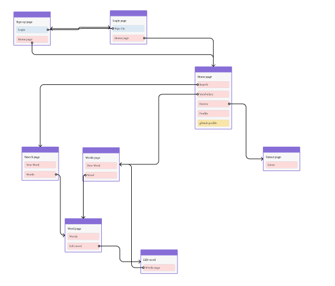

# @lp/front

React frontend for the second version of Language Power. It is the user-facing client: word search, the personal vocabulary and the learning games. Components come from the shared [`@lp/ui`](../ui/README.md) design system, and data comes from the GraphQL API in [`@lp/server`](../server/README.md).

This package is part of [language-power-v2](../../README.md). Requirements, tool versions and the full local setup are described in the root README; this file covers what is specific to the frontend.

## Stack

- React 18 and TypeScript
- React Router 6
- Apollo Client 3, with operation types generated from the shared schema by GraphQL Code Generator
- Webpack 5 with `ts-loader`, CSS Modules and `dotenv-webpack`
- ESLint and Stylelint
- Cypress 13

## Features

- Sign up and sign in
- Search English and Spanish words and add them to the vocabulary
- Add your own words, and review and edit saved ones on word cards
- Choose a game and, for verb conjugation, the verbs and tense to practise
- Switch between English and Spanish; each language has its own vocabulary and games

Most pages require a signed-in user and a running server. Without the server the frontend loads, but data requests fail.

Two features are experimental and were never finished (see [Experimental features](../../README.md#experimental-features)): the tags page with tag filters, and the speaking game, which works only in Chrome.

Site map from the design phase:



The implemented app follows this map with a few differences. A header on every page links to Home, Explore (search), Vocabulary and Practice, and a user menu links to Profile and Logout. Adding a word has its own page. Each game has its own page, and the conjugation game first opens a page for choosing verbs and a tense.

Page layouts and flows are in [Figma](https://www.figma.com/design/uLznHs3pU0bQqy7Wwn3xQx/Design-system?node-id=2-228&t=cV9Um1WVsmJJoaFu-1).

## Configuration

`dotenv-webpack` reads `.env` in this package and inlines the values into the bundle at build time, so changing them needs a restart of the dev server or a new build. Variables set in the shell or as Docker build arguments are read as well.

| Variable       | Required | Description                                                                                                                         |
| -------------- | -------- | ----------------------------------------------------------------------------------------------------------------------------------- |
| `GQL_URL`      | Yes      | GraphQL API URL, e.g. `http://localhost:4000/graphql`. Without it, requests go to `/graphql` on the frontend's own origin and fail. |
| `TOKEN_TTL`    | No       | How long the client keeps the login, in days. Defaults to `7`; keep it in line with the server's `TOKEN_TTL`.                       |
| `ALLOW_SIGNUP` | No       | Set to `true` to show the sign-up page in a production build. Development builds always show it.                                    |
| `DEMO_VERSION` | No       | Set to `true` to replace sign-in and sign-up with the demo page and hide the tags page. Matches the server's demo mode.             |

`NODE_ENV` is set by webpack from the build mode: `yarn dev` builds in development mode and `yarn prod` in production mode.

## Running

The frontend needs the server. From the repository root, `yarn start` starts both in watch mode, after the setup steps in the [root README](../../README.md#local-development-setup).

The dev server runs on `http://localhost:8080` and falls back to `index.html` for client-side routes.

`yarn prod` builds the production bundle into `public/`: minified, with extracted CSS, gzip-compressed copies of the assets, and the files from `static/` (`robots.txt` and a `_redirects` rule for single-page routing).

## Scripts

| Script               | Description                                                          |
| -------------------- | -------------------------------------------------------------------- |
| `yarn start`         | Start the webpack dev server (same as `yarn dev`)                    |
| `yarn dev`           | Start the webpack dev server in development mode                     |
| `yarn start:test`    | Start the dev server; used by the root `yarn start:test` for Cypress |
| `yarn prod`          | Production build into `public/`                                      |
| `yarn serve`         | Serve the production build from `public/` with `http-server`         |
| `yarn codegen`       | Generate operation types from the shared schema into `src/generated` |
| `yarn codegen:watch` | Regenerate types when the schema or queries change                   |
| `yarn ts`            | Type-check with `tsc -b`                                             |
| `yarn lint`          | Run ESLint                                                           |
| `yarn stylelint`     | Run Stylelint                                                        |
| `yarn ready`         | Generate types and apply ESLint and Stylelint fixes                  |
| `yarn cypress`       | Open the Cypress test runner                                         |
| `yarn cypress:run`   | Run the Cypress tests headless in Chrome                             |
| `yarn clean`         | Remove build output, generated files and `node_modules`              |

## End-to-end tests

The Cypress tests in `cypress/e2e` cover sign-up and sign-in, search, adding and editing words, the words and tags pages, and the games.

They run against the real frontend and server, and need:

1. MongoDB on `localhost:27017`. Before each test, Cypress drops and seeds the database given in `MONGO_CONNECTION`, `mongodb://localhost:27017/test` by default, so the server must use the same database.
2. `packages/server/.env` and `packages/front/.env` as described in the [root README](../../README.md#local-development-setup), with `USE_MOCKS=true` on the server.
3. Both apps running: `yarn start:test` from the root. Wait until the server prints `server is ready on port 4000`.
4. Google Chrome, which `cypress:run` uses.

Then, from the root:

```bash
yarn cypress:run
```

Images and audio that the test data links to on third-party sites (Wikimedia, Merriam-Webster and others) are served from `cypress/fixtures/media` by `cy.intercept` in `cypress/support/e2e.ts`, so the tests do not depend on those sites.
